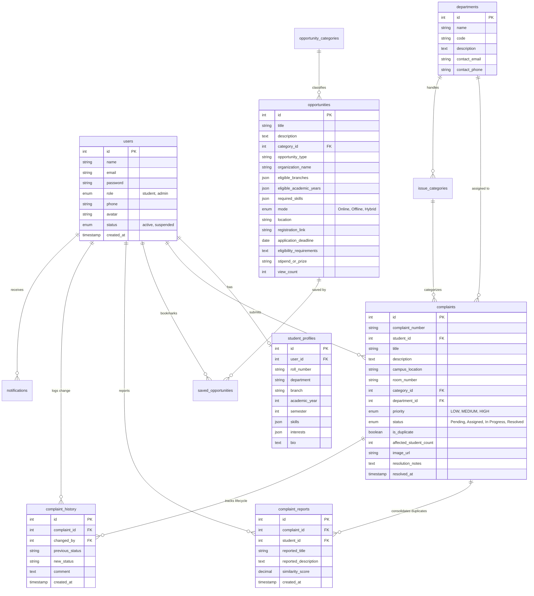
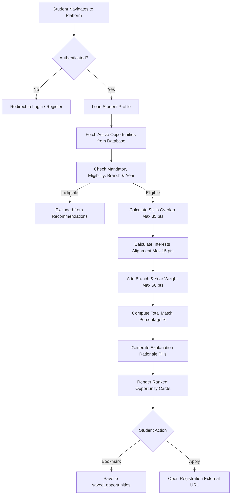
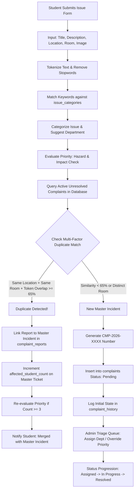

# Campus Connect – College Opportunity Aggregator & Smart Campus Issue Routing System

> **Academic Engineering Capstone Project**  
> *5th-Semester Computer Science & Engineering*  
> Full-Stack Web Application built with React.js, Vite, Tailwind CSS, Node.js, Express.js, and MySQL.

---

## Table of Contents

1. [Project Title](#1-project-title)
2. [Project Overview](#2-project-overview)
3. [Problem Statement](#3-problem-statement)
4. [Proposed Solution](#4-proposed-solution)
5. [Project Objectives](#5-project-objectives)
6. [Main Features and Functionalities](#6-main-features-and-functionalities)
7. [Detailed Explanation of Both Modules](#7-detailed-explanation-of-both-modules)
   - Module 1: College Opportunity Aggregator
   - Module 2: Smart Campus Issue Routing System
8. [User Roles and Permissions](#8-user-roles-and-permissions)
9. [Technology Stack](#9-technology-stack)
10. [System Architecture](#10-system-architecture)
11. [Project Folder Structure](#11-project-folder-structure)
12. [Database Design and Table Explanations](#12-database-design-and-table-explanations)
13. [Entity-Relationship (ER) Diagram (Mermaid)](#13-entity-relationship-er-diagram)
14. [Application Workflow Diagrams (Mermaid)](#14-application-workflow-diagrams)
15. [Opportunity Recommendation Algorithm](#15-opportunity-recommendation-algorithm)
16. [Issue Categorization Methodology](#16-issue-categorization-methodology)
17. [Department Routing Mechanism](#17-department-routing-mechanism)
18. [Priority Detection Logic](#18-priority-detection-logic)
19. [Duplicate Complaint Detection Methodology](#19-duplicate-complaint-detection-methodology)
20. [REST API Endpoint Documentation](#20-rest-api-endpoint-documentation)
21. [Installation Prerequisites](#21-installation-prerequisites)
22. [Step-by-Step Installation Instructions](#22-step-by-step-installation-instructions)
23. [MySQL Database Configuration](#23-mysql-database-configuration)
24. [Environment Variable Configuration](#24-environment-variable-configuration)
25. [Instructions to Run the Frontend and Backend](#25-instructions-to-run-the-frontend-and-backend)
26. [Sample Login Credentials from Seed Data](#26-sample-login-credentials-from-seed-data)
27. [Testing and Verification Instructions](#27-testing-and-verification-instructions)
28. [Known Limitations](#28-known-limitations)
29. [Future Enhancements](#29-future-enhancements)
30. [Conclusion](#30-conclusion)

---

## 1. Project Title
**Campus Connect: College Opportunity Aggregator & Smart Campus Issue Routing System**

---

## 2. Project Overview
**Campus Connect** is an integrated college intranet web application designed to solve two pervasive challenges in student campus life:
1. **Opportunity Fragmentation:** Students miss critical hackathons, internships, scholarships, coding contests, and research fellowships because announcements are scattered across informal WhatsApp groups, bulletin boards, and external platforms.
2. **Campus Facility Inefficiency:** When infrastructure breaks (such as a Wi-Fi router failure in a computer lab, a malfunctioning classroom projector, or water leakage), complaints are either lost in bureaucratic paper registers or submitted repeatedly by dozens of students, creating redundant tickets and delays.

Campus Connect unifies these two domains into one cohesive platform with role-based access control for **Students** and **Administrators**.

---

## 3. Problem Statement
In modern engineering colleges:
- Opportunity announcements are unstructured. Students in their 3rd year interested in Web Development often miss deadlines simply because they were not forwarded a flyer on WhatsApp or saw it after registration closed.
- Facility complaints lack tracking. When internet service drops in a 60-seat computer lab, 15 individual students may report the exact same issue to the helpdesk. Administrative staff are flooded with duplicate tickets, cannot easily isolate the root cause, and students have no visibility into when a technician was dispatched.

---

## 4. Proposed Solution
Campus Connect provides a software-driven centralized platform:
- **Module 1 (Opportunity Aggregator):** Standardized opportunity cards with strict eligibility filters, full-text keyword search, deadline alerts, bookmarks, and a **deterministic rule-based recommendation engine** that matches student branch, academic year, technical skills, and career interests.
- **Module 2 (Smart Issue Routing):** A streamlined complaint submission form with **automatic keyword-based issue categorization**, **automated department routing suggestions**, **rule-based hazard priority classification**, and a **multi-factor duplicate complaint detection engine** that consolidates multiple reports from the same room/lab into a single master incident.

---

## 5. Project Objectives
- Build a modular full-stack web application adhering to software engineering design principles.
- Implement secure JWT-based authentication and role-based route guards.
- Implement a normalized MySQL relational database schema with foreign keys and cascading integrity.
- Develop a rule-based recommendation engine with transparent mathematical score calculation without opaque AI black boxes.
- Implement natural language tokenization and similarity algorithms (Jaccard token coefficient) for duplicate complaint detection.
- Provide interactive visual dashboards using Recharts for administrative decision-making.

---

## 6. Main Features and Functionalities

### For Students:
- Secure registration with academic branch, year, semester, skills tags, and career interests.
- **Opportunity Catalog:** Multi-factor filtering (by Category, Branch, Year, Required Skill, Mode, Approaching Deadline &lt; 7 days).
- **Personalized Recommendations:** Rule-based matching score percentage (e.g. 95% Match) with transparent rationale pills explaining why the opportunity is recommended.
- **Saved Bookmarks:** Save and manage opportunities of interest.
- **Issue Submission:** Report maintenance problems with location, room number, optional photo attachment, and real-time category detection.
- **Duplicate Awareness:** Instant alert if a matching unresolved issue is already active in that room, linking the report and incrementing the affected student counter.
- **Status Stepper:** Track complaint lifecycle (`Pending` &rarr; `Assigned` &rarr; `In Progress` &rarr; `Resolved`) with technician resolution notes.

### For Administrators:
- **Operations Dashboard:** Real-time statistics, Recharts bar charts for department complaint loads, lifecycle status distribution pie charts, and most saved opportunities.
- **Opportunity Management (CRUD):** Add, edit, delete, and configure eligibility criteria for opportunities.
- **Complaints Triage:** View all campus complaints, override priority (`HIGH`, `MEDIUM`, `LOW`), assign or reassign responsible departments, update statuses, and log resolution comments.
- **Duplicate Incident Monitoring:** Inspect master incidents and review individual student reports merged under that location.
- **Departments & Keyword Rules:** Manage campus departments and customize the keyword dictionaries powering automated classification.
- **Student Directory:** View registered students, roll numbers, branches, and toggle active/suspended account statuses.

---

## 7. Detailed Explanation of Both Modules

### Module 1: College Opportunity Aggregator
Module 1 centralizes college-related opportunities:
1. **Cataloging:** Each opportunity contains Title, Organization Name, Category (Hackathon, Internship, Workshop, Competition, Scholarship, Research, Coding Contest, Event), Eligible Branches, Eligible Academic Years, Required Skills, Mode (Online/Offline/Hybrid), Location, Deadline, Registration URL, and Stipend/Prize.
2. **Filtering Engine:** Students can filter opportunities simultaneously across categories, branch requirements, year requirements, required skills, and approaching deadlines.
3. **Recommendation Engine:** Evaluates candidate opportunities against the student's profile. Checks mandatory branch and year eligibility, computes skill overlap and interest alignment, and calculates an overall match percentage.
4. **Bookmarking:** One-click saving to keep deadlines visible on the student dashboard.

### Module 2: Smart Campus Issue Routing System
Module 2 automates campus facility maintenance:
1. **Complaint Submission:** Captures title, detailed description, campus building, room/lab number, and optional image.
2. **Keyword Categorization:** Natural language tokenizer compares the text against configured keyword dictionaries:
   - `wifi`, `internet`, `network`, `lan`, `router` &rarr; **IT / Network**
   - `projector`, `computer`, `monitor`, `screen`, `display` &rarr; **Technical Equipment**
   - `light`, `fan`, `electricity`, `switch`, `power`, `spark` &rarr; **Electrical**
   - `water`, `tap`, `leakage`, `pipe`, `washroom`, `toilet` &rarr; **Plumbing**
   - `desk`, `chair`, `bench`, `door`, `window`, `board` &rarr; **Infrastructure**
3. **Department Routing:** Automatically suggests the responsible facilities department (e.g. IT & Network Services, Electrical Maintenance, Plumbing & Water Works, Civil & Infrastructure, Technical Equipment & AV).
4. **Priority Classification:** Detects critical hazard keywords (`outage`, `hazard`, `spark`, `fire`, `flood`, `burst`, `entire lab`) to assign `HIGH` priority, classroom AV failures as `MEDIUM`, and routine cosmetic maintenance as `LOW`.
5. **Duplicate Detection:** Calculates multi-factor similarity across building match, exact room match, category match, and tokenized text overlap. If similarity score &ge; 65, the report is linked to the existing unresolved master incident, incrementing the count of affected students.

---

## 8. User Roles and Permissions

The system operates strictly on **Two Roles**:

| Feature / Action | Student | Administrator |
| :--- | :---: | :---: |
| Self-Registration & Login | Yes | Login Only (Pre-seeded) |
| Manage Profile (Branch, Year, Skills, Interests) | Yes | View Only |
| Browse & Search Opportunities | Yes | Yes |
| Personalized Match Recommendations | Yes | N/A |
| Bookmark / Save Opportunities | Yes | N/A |
| Create, Edit, Delete Opportunities | No | Yes |
| Submit Campus Issue / Complaint | Yes | No |
| Track Personal Complaints & Stepper Timeline | Yes | N/A |
| View All Campus Complaints & Triage Queue | No | Yes |
| Override Issue Priority & Assign Department | No | Yes |
| Update Complaint Status (`Pending` &rarr; `Resolved`) | No | Yes |
| Review Duplicate Reports & Affected Count | View Link | Full Inspection |
| View Recharts Analytics & Department Loads | No | Yes |
| Manage Departments & Keyword Dictionaries | No | Yes |
| Manage Student Directory & Account Status | No | Yes |

---

## 9. Technology Stack

### Frontend:
- **React.js (v18.3):** Declarative component-based user interface.
- **Vite (v5.4):** High-speed modern frontend bundler.
- **Tailwind CSS (v3.4):** Modern utility-first styling for SaaS-grade responsive design.
- **React Router DOM (v6.28):** Client-side SPA routing and role-based route guards.
- **Axios (v1.7):** Promise-based HTTP client with request and response interceptors.
- **Lucide React:** Consistent iconography.
- **Recharts (v2.15):** Responsive SVG-based analytics visualizations.

### Backend:
- **Node.js (v22.x):** JavaScript runtime.
- **Express.js (v4.21):** RESTful routing, middleware, and request handling.
- **JSON Web Token (jsonwebtoken v9.0):** Cryptographically signed authentication tokens.
- **bcryptjs (v2.4):** Salted password hashing (cost factor 10).
- **Multer (v1.4):** Multipart form-data handling for file and image uploads.
- **dotenv (v16.4):** Environment variable isolation.
- **morgan (v1.10):** HTTP request logging.

### Database:
- **MySQL (v9.x / v8.x):** Relational database management system.
- **mysql2 (v3.12):** High-performance MySQL connection pool with Promise support.
- **Dual-Mode Resilient Architecture:** Auto-initializes MySQL pool; if MySQL is temporarily offline during initial development, seamlessly serves pre-seeded data via an in-memory transactional fallback store without crashing.

---

## 10. System Architecture

```
                       +---------------------------------------+
                       |             Client (React)            |
                       | Vite + Tailwind CSS + Lucide + Recharts |
                       +-------------------+-------------------+
                                           |
                                  HTTPS / REST JSON
                                           |
                                           v
                       +---------------------------------------+
                       |          Express.js Backend           |
                       |  - Auth & Role Middleware             |
                       |  - Multer File Upload Middleware      |
                       +-----+-------------+-------------+-----+
                             |             |             |
        +--------------------+             |             +--------------------+
        v                                  v                                  v
+------------------------+     +------------------------+     +------------------------+
| Recommendation Engine  |     | Categorization Engine  |     |   Duplicate Detection  |
| - Mandatory Filter     |     | - Text Tokenization    |     | - Location Normalizer  |
| - Skill Overlap Match  |     | - Keyword Scoring      |     | - Jaccard Similarity   |
| - Interest Alignment   |     | - Department Mapping   |     | - Master Incident Link |
+------------------------+     +------------------------+     +------------------------+
                                           |
                                           v
                       +---------------------------------------+
                       |              Data Layer               |
                       |    MySQL 9.0 Pool (mysql2/promise)    |
                       |  [Auto-Init & Resilient Fallback Engine] |
                       +-------------------+-------------------+
                                           |
                                           v
                       +---------------------------------------+
                       |            campus_connect DB          |
                       |   - users           - complaints      |
                       |   - opportunities   - saved_opps      |
                       |   - departments     - categories      |
                       +---------------------------------------+
```

---

## 11. Project Folder Structure

```
JSF PROJECT/
├── client/
│   ├── public/
│   │   └── favicon.svg
│   ├── src/
│   │   ├── components/
│   │   │   ├── common/
│   │   │   │   ├── Badge.jsx             # Status, Priority, Match percentage badges
│   │   │   │   ├── Modal.jsx             # Reusable animated popup modal
│   │   │   │   └── StatCard.jsx          # Metric cards for dashboards
│   │   │   ├── opportunities/
│   │   │   │   ├── OpportunityCard.jsx   # Opportunity card with save & match preview
│   │   │   │   └── OpportunityModal.jsx  # Detailed opportunity dialog with apply link
│   │   │   └── complaints/
│   │   │       ├── ComplaintCard.jsx     # Complaint ticket card with affected count
│   │   │       ├── ComplaintDetailModal.jsx # Admin triage & student status tracking
│   │   │       └── StatusTimeline.jsx    # Visual 4-step progress stepper
│   │   ├── context/
│   │   │   ├── AuthContext.jsx           # User session, login, register, logout
│   │   │   └── NotificationContext.jsx   # Toast alerts notification manager
│   │   ├── layouts/
│   │   │   ├── AppLayout.jsx             # Protected layout (Sidebar + Navbar + Outlet)
│   │   │   ├── Navbar.jsx                # Top bar with notifications & user profile
│   │   │   └── Sidebar.jsx               # Responsive sidebar navigation
│   │   ├── pages/
│   │   │   ├── LandingPage.jsx           # Public home page with demo presets
│   │   │   ├── auth/
│   │   │   │   ├── LoginPage.jsx         # Sign in with 1-click test credentials
│   │   │   │   └── RegisterPage.jsx      # Student registration with skill tags
│   │   │   ├── student/
│   │   │   │   ├── StudentDashboard.jsx  # Overview, recommendations, recent tickets
│   │   │   │   ├── ExploreOpportunities.jsx # Opportunity catalog & search
│   │   │   │   ├── RecommendedOpportunities.jsx # Personalized rule-based matches
│   │   │   │   ├── SavedOpportunities.jsx # Bookmarked items
│   │   │   │   ├── ReportIssue.jsx       # Complaint submission with auto-suggestions
│   │   │   │   ├── MyComplaints.jsx      # Student's personal reports & stepper
│   │   │   │   └── StudentProfile.jsx    # Profile management for recommendations
│   │   │   └── admin/
│   │   │       ├── AdminDashboard.jsx    # Metrics overview & Recharts charts
│   │   │       ├── AdminOpportunities.jsx# Opportunity catalog CRUD
│   │   │       ├── AdminComplaints.jsx   # Triage queue, status, priority overrides
│   │   │       ├── AdminDepartments.jsx  # Departments & keyword dictionaries
│   │   │       └── AdminStudents.jsx     # Student directory & status controls
│   │   ├── services/
│   │   │   ├── api.js                    # Axios instance with auth interceptor
│   │   │   ├── authService.js            # Auth endpoints wrapper
│   │   │   ├── opportunityService.js     # Opportunities API wrapper
│   │   │   ├── complaintService.js       # Complaints API wrapper
│   │   │   └── adminService.js           # Admin operations API wrapper
│   │   ├── utils/
│   │   │   └── constants.js              # Branches, years, skills, colors
│   │   ├── App.jsx                       # Application router & protected routes
│   │   ├── main.jsx                      # React DOM root entry point
│   │   └── index.css                     # Tailwind CSS directives
│   ├── index.html                        # HTML entry point
│   ├── package.json                      # Client dependencies & scripts
│   ├── vite.config.js                    # Vite bundler configuration & proxy
│   ├── tailwind.config.js                # Tailwind theme extensions
│   └── postcss.config.js                 # PostCSS configuration
│
├── server/
│   ├── config/
│   │   ├── db.js                         # MySQL pool connection + resilient engine
│   │   └── jwt.js                        # JWT signing and verification helpers
│   ├── controllers/
│   │   ├── authController.js             # Registration, login, profile management
│   │   ├── opportunityController.js      # Opportunity discovery, recommendations, CRUD
│   │   ├── complaintController.js        # Complaint submission, duplicate triage, status
│   │   ├── adminController.js            # Analytics overview, users, departments
│   │   └── notificationController.js     # User in-app notifications
│   ├── database/
│   │   ├── schema.sql                    # MySQL table structure
│   │   ├── seed.sql                      # Seed data for demo accounts and opportunities
│   │   └── initDb.js                     # Script to initialize database & tables
│   ├── middleware/
│   │   ├── authMiddleware.js             # JWT bearer verification
│   │   ├── roleMiddleware.js             # Role-based access control (RBAC)
│   │   ├── uploadMiddleware.js           # Multer disk storage & image validation
│   │   └── errorMiddleware.js            # Centralized exception handling
│   ├── routes/
│   │   ├── authRoutes.js                 # /api/auth routes
│   │   ├── opportunityRoutes.js          # /api/opportunities routes
│   │   ├── complaintRoutes.js            # /api/complaints routes
│   │   ├── adminRoutes.js                # /api/admin routes
│   │   └── notificationRoutes.js         # /api/notifications routes
│   ├── services/
│   │   ├── recommendationEngine.js       # Rule-based opportunity matching algorithm
│   │   ├── categorizationEngine.js       # Keyword token matching for issue categories
│   │   ├── priorityEngine.js             # Rule-based priority detection (HIGH/MED/LOW)
│   │   ├── duplicateDetectionEngine.js   # Multi-factor duplicate incident detection
│   │   └── routingEngine.js              # Configurable department routing
│   ├── utils/
│   │   └── textSimilarity.js             # Tokenizer, stopword filter, Jaccard index
│   ├── uploads/                          # Stored complaint attachment photos
│   ├── test-runner.js                    # Automated integration test suite
│   ├── .env.example                      # Server environment template
│   ├── .env                              # Server environment configuration
│   ├── server.js                         # Express application entry point
│   └── package.json                      # Server dependencies & scripts
│
├── .env.example                          # Root environment template
├── .gitignore                            # Git exclusion rules
└── README.md                             # Academic project documentation
```

---

## 12. Database Design and Table Explanations

The database schema is normalized to 3NF, utilizing foreign keys, cascading deletions where appropriate, and indexed lookup fields.

1. `users`: Stores core credentials, role (`student` or `admin`), phone, avatar URL, and account status (`active` or `suspended`).
2. `student_profiles`: 1-to-1 extension of `users` for students. Stores `roll_number`, `department`, `branch`, `academic_year`, `semester`, JSON array of `skills`, JSON array of `interests`, and `bio`.
3. `departments`: Campus facilities departments responsible for resolutions (e.g. IT & Network Services, Electrical Maintenance, Plumbing & Water Works).
4. `opportunity_categories`: Categories of college opportunities (Hackathons, Internships, Workshops, Competitions, Scholarships, Research, Coding Contests, Events).
5. `opportunities`: Master record of all posted opportunities with title, description, category, organization, eligible branches JSON, eligible years JSON, required skills JSON, mode, location, deadline, registration URL, prize, and view count.
6. `saved_opportunities`: Association table linking students to bookmarked opportunities (`student_id`, `opportunity_id`, `saved_at`) with unique constraint preventing duplicate saves.
7. `issue_categories`: Categories for campus complaints with configurable JSON `keywords` array, description, default department foreign key, and default priority.
8. `complaints`: Master complaints/incidents table. Stores unique `complaint_number` (e.g. `CMP-2026-0001`), `student_id`, title, description, `campus_location`, `room_number`, `category_id`, `department_id`, `priority` (`LOW`, `MEDIUM`, `HIGH`), `status` (`Pending`, `Assigned`, `In Progress`, `Resolved`), `is_duplicate` flag, `affected_student_count`, optional `image_url`, `resolution_notes`, and `resolved_at` timestamp.
9. `complaint_reports`: Stores individual student submissions linked to a master incident when duplicate complaints are detected, preserving individual student descriptions, timestamps, and similarity scores.
10. `complaint_history`: Complete audit log recording every status transition, the user who triggered it, the previous status, the new status, and resolution comments.
11. `notifications`: In-app alerts informing users of complaint status changes, new opportunity matches, and administrative actions.

---

## 13. Entity-Relationship (ER) Diagram



---

## 14. Application Workflow Diagrams

### 14.1 Opportunity Discovery & Recommendation Workflow


### 14.2 Smart Campus Issue Routing & Duplicate Detection Workflow


---

## 15. Opportunity Recommendation Algorithm

The recommendation engine implements a **rule-based multi-factor matching model** that is transparent and deterministic:

### Step 1: Mandatory Eligibility Gate
Before calculating scores, the system verifies:
$$\text{Branch Eligible} = (\text{Eligible Branches contains } \text{Student Branch}) \lor (\text{Eligible Branches contains 'ALL'})$$
$$\text{Year Eligible} = (\text{Eligible Years contains } \text{Student Year}) \lor (\text{Eligible Years contains 'ALL'})$$
If either condition evaluates to false, $\text{Match Percentage} = 0\%$ and the opportunity is disqualified from the recommended feed.

### Step 2: Weighted Component Scoring (Total: 100 Points)
1. **Branch Match (Max 25 pts):**
   - Direct match to student branch (e.g. CSE): $+25$ points.
   - Open to ALL departments: $+18$ points.
2. **Academic Year Match (Max 25 pts):**
   - Direct match to student year (e.g. Year 3): $+25$ points.
   - Open to ALL academic years: $+18$ points.
3. **Skill Overlap (Max 35 pts):**
   $$\text{Skill Points} = \left(\frac{|\text{Matching Skills}|}{|\text{Required Skills}|}\right) \times 35$$
   If no specific skills are required, 25 points are granted by default.
4. **Interest Alignment (Max 15 pts):**
   Scans student interests against title, description, and opportunity type. $+8$ points per matched interest up to 15 points.

$$\text{Final Percentage} = \min(100, \text{Branch} + \text{Year} + \text{Skills} + \text{Interests})$$

### Step 3: Human-Readable Rationale Generation
The system builds transparent explanation strings displayed directly on the card:
- *"Directly targets your branch: CSE"*
- *"Specifically tailored for Year 3 students"*
- *"Matches 4 of your skills (React, Node.js, Python, SQL)"*
- *"Aligns with your interests in Web Development and Hackathons"*

---

## 16. Issue Categorization Methodology

Natural language text in the complaint title and description is normalized:
1. Converted to lowercase and stripped of punctuation.
2. Filtered against standard English stopwords (`the`, `is`, `at`, `which`, `please`, `urgent`, etc.).
3. Weighted scoring:
   - Tokens in the **Title** receive $3\times$ weight due to high semantic density.
   - Tokens in the **Description** receive $1\times$ weight.
4. The system calculates token overlap with each category's configured keyword dictionary:
   - **IT / Network:** `wifi`, `internet`, `network`, `lan`, `router`, `ethernet`, `ip`, `dns`, `connection`
   - **Technical Equipment:** `projector`, `computer`, `monitor`, `pc`, `screen`, `display`, `speaker`, `hdmi`, `ups`
   - **Electrical:** `light`, `tube`, `fan`, `electricity`, `socket`, `power`, `switch`, `ac`, `voltage`, `spark`
   - **Plumbing:** `water`, `tap`, `leakage`, `pipe`, `washroom`, `toilet`, `sink`, `drainage`, `overflow`
   - **Infrastructure:** `desk`, `chair`, `bench`, `furniture`, `door`, `window`, `whiteboard`, `tile`, `ceiling`
5. Confidence threshold: Requires at least 2 points (1 title keyword or 2 description keywords) to assign automatically. Students can also manually select or confirm the suggested category.

---

## 17. Department Routing Mechanism

Complaints are automatically routed to campus departments via a category-to-department mapping table:
- **IT / Network** &rarr; IT & Network Services Department
- **Technical Equipment** &rarr; Technical Equipment & AV Department
- **Electrical** &rarr; Electrical Maintenance Department
- **Plumbing** &rarr; Plumbing & Water Works Department
- **Infrastructure** &rarr; Civil & Infrastructure Department

Administrators retain full authority to reassign complaints to any department with one click from the administrative triage panel.

---

## 18. Priority Detection Logic

The system evaluates safety hazards, instructional disruptions, and crowd impact:
- **HIGH Priority:**
  - Presence of critical hazard keywords: `outage`, `hazard`, `fire`, `shock`, `spark`, `burst`, `flood`, `burning`, `all computers`, `entire lab`, `blackout`.
  - Or, when $\text{Affected Student Count} \ge 3$ at the same room/lab.
- **MEDIUM Priority:**
  - Malfunctions affecting classroom instruction: `projector`, `multiple fans`, `fan not working`, `ac not working`, `audio`, `screen`, `display`.
- **LOW Priority:**
  - Routine non-urgent maintenance: `chair`, `desk`, `bench`, `furniture`, `door handle`, `paint`, `creak`.

Administrators can override the assigned priority at any time, with the reason recorded in the complaint audit history.

---

## 19. Duplicate Complaint Detection Methodology

Duplicate complaint detection solves the problem of multiple students reporting the exact same incident from the same room or laboratory.

### Multi-Factor Similarity Formula
When a new complaint $C_{\text{new}}$ is submitted, it is evaluated against all active unresolved master complaints $C_{\text{active}}$ created within the last 14 days:

$$\text{Similarity Score} = S_{\text{building}} + S_{\text{room}} + S_{\text{category}} + S_{\text{text}}$$

1. **Building Match ($S_{\text{building}}$ = 25 pts):** Normalized string check on campus building (`Tech Tower`, `Academic Block A`, etc.). If buildings do not match, score is 0.
2. **Room / Lab Match ($S_{\text{room}}$ = 35 pts):** Normalized fuzzy string comparison (`Lab 4` == `lab-4` == `Lab4`).
3. **Category Match ($S_{\text{category}}$ = 20 pts):** Evaluates if both complaints share the same issue category.
4. **Semantic Text Similarity ($S_{\text{text}}$ = 20 pts):** Calculates the **Jaccard similarity coefficient** on tokenized, stopword-stripped words:
   $$J(A, B) = \frac{|A \cap B|}{|A \cup B|}$$
   $$S_{\text{text}} = \text{round}(J(A, B) \times 20)$$

### Decision Threshold
- If $\text{Similarity Score} \ge 65\%$:
  - Flagged as a **Duplicate Incident**.
  - Merged with the existing Master Incident.
  - A new entry is recorded in `complaint_reports` preserving the individual student's description.
  - The master complaint's `affected_student_count` is incremented.
  - The student is notified: *"Possible duplicate issue detected! 3 reports from Lab 4. Your report has been associated with Incident #CMP-2026-0001."*

---

## 20. REST API Endpoint Documentation

All endpoints return JSON responses in the format `{ success: true|false, message, ...data }`. Authenticated requests require the `Authorization: Bearer <token>` header.

### Authentication Endpoints (`/api/auth`)
| Method | Endpoint | Access | Description |
| :--- | :--- | :--- | :--- |
| `POST` | `/api/auth/register` | Public | Register a student account with branch, year, skills, interests |
| `POST` | `/api/auth/login` | Public | Authenticate user and receive JWT bearer token |
| `GET` | `/api/auth/me` | Authenticated | Retrieve current user profile and session details |
| `PUT` | `/api/auth/profile` | Authenticated | Update student profile skills, interests, and bio |

### Opportunity Aggregator Endpoints (`/api/opportunities`)
| Method | Endpoint | Access | Description |
| :--- | :--- | :--- | :--- |
| `GET` | `/api/opportunities` | Authenticated | Filter opportunities (category, branch, year, skill, mode, deadline) |
| `GET` | `/api/opportunities/categories` | Authenticated | Fetch list of opportunity categories |
| `GET` | `/api/opportunities/recommended` | Student | Get personalized recommendations ranked by rule-based match % |
| `GET` | `/api/opportunities/saved` | Student | Fetch bookmarked opportunities |
| `GET` | `/api/opportunities/:id` | Authenticated | Get full details of an opportunity and increment view count |
| `POST` | `/api/opportunities/:id/save` | Student | Bookmark an opportunity |
| `DELETE` | `/api/opportunities/:id/save` | Student | Remove an opportunity from bookmarks |
| `POST` | `/api/opportunities` | Admin | Create a new opportunity |
| `PUT` | `/api/opportunities/:id` | Admin | Edit existing opportunity |
| `DELETE` | `/api/opportunities/:id` | Admin | Delete an opportunity |

### Smart Campus Issue Routing Endpoints (`/api/complaints`)
| Method | Endpoint | Access | Description |
| :--- | :--- | :--- | :--- |
| `POST` | `/api/complaints` | Student | Submit complaint (with Multer photo upload, auto-categorize & duplicate check) |
| `GET` | `/api/complaints/my` | Student | Get complaints submitted by logged-in student and linked duplicate reports |
| `GET` | `/api/complaints/categories` | Authenticated | Get issue categories and configured keywords |
| `GET` | `/api/complaints/departments` | Authenticated | Get list of campus facilities departments |
| `GET` | `/api/complaints` | Admin | Get all campus complaints with filter support |
| `GET` | `/api/complaints/:id` | Authenticated | Get complaint details, history timeline, and merged duplicate reports |
| `PUT` | `/api/complaints/:id/status` | Admin | Update status (`Pending`, `Assigned`, `In Progress`, `Resolved`) & notes |
| `PUT` | `/api/complaints/:id/priority` | Admin | Override priority (`LOW`, `MEDIUM`, `HIGH`) with justification |
| `PUT` | `/api/complaints/:id/assign` | Admin | Assign or reassign complaint to a department |

### Administration Endpoints (`/api/admin`)
| Method | Endpoint | Access | Description |
| :--- | :--- | :--- | :--- |
| `GET` | `/api/admin/overview` | Admin | Aggregate dashboard analytics, Recharts datasets, and duplicate alerts |
| `GET` | `/api/admin/users` | Admin | Student directory with search and branch filter |
| `PUT` | `/api/admin/users/:id/status` | Admin | Toggle student account status (`active` / `suspended`) |
| `POST` | `/api/admin/departments` | Admin | Create campus facilities department |
| `PUT` | `/api/admin/departments/:id` | Admin | Update department details |
| `DELETE` | `/api/admin/departments/:id` | Admin | Delete department |
| `PUT` | `/api/admin/categories/:id` | Admin | Update keyword mappings dictionary for a category |

### Notification Endpoints (`/api/notifications`)
| Method | Endpoint | Access | Description |
| :--- | :--- | :--- | :--- |
| `GET` | `/api/notifications` | Authenticated | Fetch notifications for current user |
| `PUT` | `/api/notifications/read-all` | Authenticated | Mark all notifications as read |

---

## 21. Installation Prerequisites
Before running the project, verify that your machine has:
1. **Node.js:** v18.0.0 or later (v20+ recommended). Check with `node -v`.
2. **npm:** v9.0.0 or later. Check with `npm -v`.
3. **MySQL Server:** v8.0 or v9.0 installed and running (via Homebrew, XAMPP, or native installer).

---

## 22. Step-by-Step Installation Instructions

### 1. Clone or Open the Project
```bash
cd "JSF PROJECT"
```

### 2. Install Server Dependencies
```bash
cd server
npm install
```

### 3. Install Client Dependencies
```bash
cd ../client
npm install
```

---

## 23. MySQL Database Configuration

1. Start your local MySQL service:
   ```bash
   # On macOS via Homebrew:
   brew services start mysql
   # Or start via macOS System Settings / XAMPP / MySQL Preference Pane
   ```

2. Configure environment credentials in `server/.env` (see Section 24).

3. Initialize the database schema and seed data:
   ```bash
   cd server
   npm run init-db
   ```
   This automatically creates the `campus_connect` database, creates all 11 normalized tables, and loads the seed data.

> **Resilient Fallback Mode:** If your MySQL daemon is not running yet during development or sandbox evaluation, the server automatically boots in **Fallback Resilient Mode**, preloading identical seed data into a memory store so every API endpoint, auth check, recommendation, duplicate detection, and UI page works immediately without crashing!

---

## 24. Environment Variable Configuration

Create `server/.env` using `server/.env.example`:
```env
PORT=5001
NODE_ENV=development

# MySQL Database Configuration
DB_HOST=127.0.0.1
DB_PORT=3306
DB_USER=root
DB_PASSWORD=
DB_NAME=campus_connect

# JWT Secret
JWT_SECRET=campus_connect_academic_project_jwt_secret_key_2026
JWT_EXPIRES_IN=7d
```

Frontend environment file (`client/.env` or default Vite proxy):
```env
VITE_API_URL=http://localhost:5001/api
```

---

## 25. Instructions to Run the Frontend and Backend

Run the backend and frontend in two separate terminal windows:

### Terminal 1 – Start Backend Server:
```bash
cd server
npm start
# Server listens on http://localhost:5001
```

### Terminal 2 – Start Frontend Client:
```bash
cd client
npm run dev
# Vite dev server runs at http://localhost:5173
```

Open your browser and navigate to: **`http://localhost:5173`**

---

## 26. Sample Login Credentials from Seed Data

The database includes pre-configured demo accounts for academic evaluation:

| Role | Email Address | Password | Profile Summary |
| :--- | :--- | :--- | :--- |
| **Administrator** | `admin@campusconnect.edu` | `Admin@123` | System Administrator with full operational controls |
| **Student (CSE)** | `arjun.sharma@campusconnect.edu` | `Student@123` | 3rd Year CSE, Web Dev, React, Node.js, Python |
| **Student (IT)** | `priya.patel@campusconnect.edu` | `Student@123` | 2nd Year IT, Cloud Computing, Cybersecurity |
| **Student (ECE)** | `rohit.verma@campusconnect.edu` | `Student@123` | 4th Year ECE, Robotics, IoT, C++, Embedded |
| **Student (CSE)** | `sneha.reddy@campusconnect.edu` | `Student@123` | 3rd Year CSE, Machine Learning, Data Science |

> **Convenience Feature:** The Login Page includes **"Student Demo"** and **"Admin Demo"** 1-click buttons that automatically populate credentials for immediate evaluation.

---

## 27. Testing and Verification Instructions

### Automated Integration Test Suite
The codebase includes an automated test runner verifying 10 critical workflows:
```bash
cd server
node test-runner.js
```
**Verified Tests:**
1. Health endpoint check (`/api/health`).
2. Student authentication & JWT issuance.
3. Administrator authentication & JWT issuance.
4. Opportunity catalog filtering.
5. Personalized recommendation rule-based match calculation.
6. Opportunity bookmarking & retrieval.
7. Complaint submission with automatic categorization and department routing.
8. Duplicate complaint detection and master incident report consolidation.
9. Administrator analytics overview and Recharts datasets.
10. Complaint status update and resolution notes audit.

### Manual Verification Checklist:
- **Test 1 (Recommendations):** Log in as `arjun.sharma@campusconnect.edu`. Visit *Recommended For You*. Note that *Smart India Campus Hackathon 2026* shows a **98% Match** with detailed reasons matching Arjun's CSE branch, Year 3 standing, and React/Node/Python skills.
- **Test 2 (Duplicate Detection):** Go to *Report Issue*. Click the preset button **"Duplicate Test (Lab 4 Wi-Fi)"**. Submit the form. The system detects the active incident at Tech Tower Lab 4 and displays an alert indicating the report was merged with Master Ticket `#CMP-2026-0001` (4 students affected).
- **Test 3 (Admin Triage):** Log in as `admin@campusconnect.edu`. Open *Campus Complaints*. Click ticket `#CMP-2026-0001`. Review the consolidated duplicate reports submitted by different students. Change status to `In Progress` or `Resolved` and add resolution notes.
- **Test 4 (Admin Opportunity CRUD):** Go to *Manage Opportunities*. Click *Post New Opportunity*, fill in title and deadline, and submit. The new opportunity appears instantly in the student catalog.

---

## 28. Known Limitations
1. **Manual Opportunity Entry:** Opportunities are currently posted by administrators through the admin portal. Automated scraping from WhatsApp groups is not supported due to WhatsApp End-to-End Encryption and Terms of Service.
2. **Local File Storage:** Uploaded complaint images are saved to local disk in `server/uploads/` rather than a cloud CDN bucket (such as AWS S3 or Cloudinary).
3. **Single College Scope:** Designed for an individual college campus; multi-campus institutional clustering is not implemented.

---

## 29. Future Enhancements
- **Push & WhatsApp Notification Webhooks:** Real-time SMS or WhatsApp alerts via Twilio when high-priority complaints are resolved.
- **QR Code Scanning at Classrooms:** Affixing unique QR codes in every laboratory and lecture hall so students can scan the code on their phones to auto-fill building and room numbers.
- **Student Peer Discussion Forum:** Dedicated Q&A threads under hackathon opportunities for students seeking teammates.
- **Technician Mobile Field Interface:** Dedicated mobile view for facilities technicians to upload "after repair" completion photos.

---

## 30. Conclusion
**Campus Connect** demonstrates a practical, end-to-end full-stack engineering solution for academic institutions. By replacing fragmented communication channels with a centralized **Opportunity Aggregator** and replacing paper registers with an automated **Smart Campus Issue Routing System**, the application improves student career participation and campus facilities uptime. The project highlights clean architecture, robust relational database design, role-based security, and deterministic algorithms suitable for real-world academic deployment.

